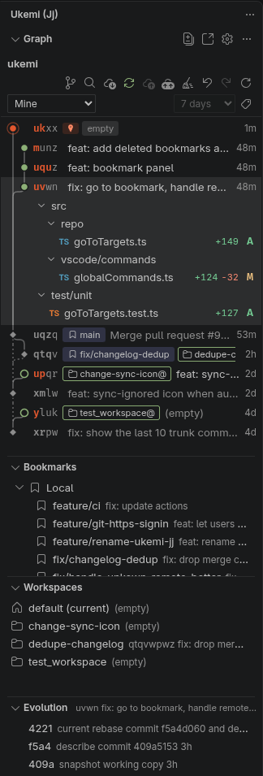
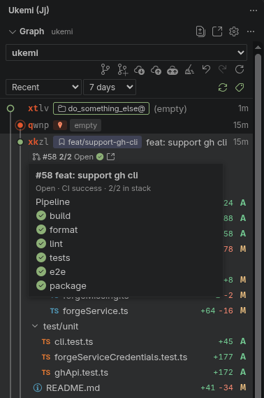
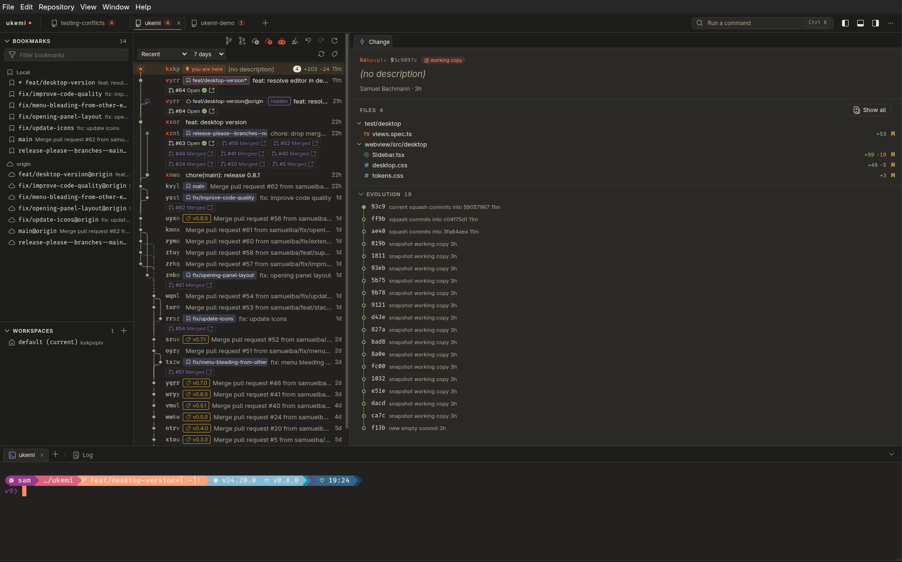
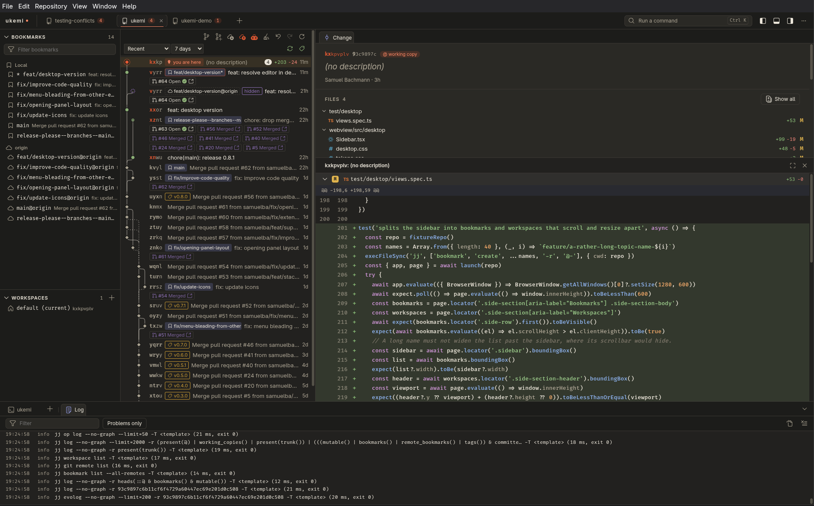
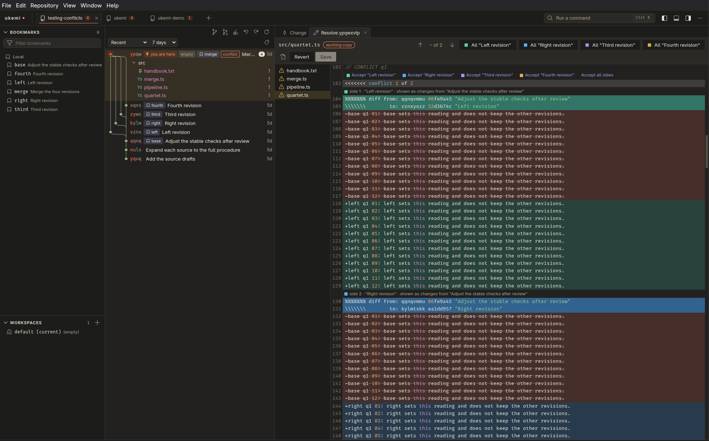

# Ukemi: Jujutsu (jj) GUI

[](https://github.com/samuelba/ukemi/actions/workflows/ci.yml)

<p align="center">
  
</p>

Ukemi is a visual interface for [Jujutsu (jj)](https://jj-vcs.github.io/jj/) in VS Code, Cursor, or its own window. In judo, _ukemi_ is the art of falling safely. With jj and `undo`, every change is safe to try.

There are two ways to use Ukemi:

- **Extension.** For VS Code, Cursor, VSCodium, Windsurf and other editors built on VS Code. Ukemi sits in the sidebar next to your files. Install it from the [VS Code Marketplace](https://marketplace.visualstudio.com/items?itemName=samuelba.ukemi-jj) or [Open VSX](https://open-vsx.org/extension/samuelba/ukemi-jj).
- **Desktop app.** For JetBrains IDEs, other editors, or when you want jj in a separate window. Open several repositories in tabs, with a built-in terminal and a log of every jj command. Download it from the [GitHub releases](https://github.com/samuelba/ukemi/releases/latest) for Linux, macOS and Windows. See [Desktop app](#desktop-app).

| Extension overview                         | Stacked pull request hover                                     |
| ------------------------------------------ | -------------------------------------------------------------- |
|  |  |



## Features

- **Change graph.** See your changes, bookmarks, tags, workspaces and conflicts. The working copy has a red seal. Filter by _Recent_, _Mine_, _My history_, _Stack_ or _Working copy_ (the working copy and its last 5 first parents) and choose the history depth. _Recent_ also shows the last 10 commits on the trunk. Changed files appear as a list or a tree.
- **Drag and drop.** Drag a change onto another change to rebase it with its descendants. Hold Alt to move only that change. Hold Ctrl to duplicate it onto the target, and hold Ctrl and Alt to duplicate it with its descendants. Drag a file to move its changes, or hold Ctrl to copy them. Drag a bookmark to move it.
- **Edit history.** Use the context menu or the hover action to describe, create, edit, squash, split, abandon, duplicate and revert changes. Rebase onto the trunk, onto another change, or insert the change before or after another. **Ship to Trunk Now** moves the trunk bookmark to that change and pushes it. **New Change from Trunk** starts a working copy on the trunk. **New Change from Bookmark, Request or Revision** opens a new working copy there. When a local bookmark and a remote bookmark share a name, Ukemi asks which one to use. Click a change to show or hide its files.
- **Suggested descriptions.** The describe dialog has a button for each AI coding tool you have installed: Claude Code, Cursor CLI or GitHub Copilot CLI, and in VS Code also Copilot Chat. It suggests a description from the change's diff. See [Suggested descriptions](#suggested-descriptions).
- **Bookmarks.** The Bookmarks panel lists local bookmarks and remote bookmarks. **Filter Bookmarks** in the view title filters that list by bookmark name. Hover a row to open it as the working copy, edit, rename, delete, forget, track, untrack or push it. The context menu can also create a pull or merge request, or a new workspace.
- **Workspaces.** The Workspaces panel lists workspaces. Open one in this window or a new window, open a terminal, refresh it, reveal it in the graph, or start a new change in it.
- **Split by hunks.** Select hunks in a split editor. The selected hunks go into a new change before the original. You can also split by files.
- **Evolution.** The Evolution panel shows how the selected change evolved: each amend, describe, snapshot and rebase. Select a change in the graph. Click a version to see what it changed, compare it with the current version, or restore its files. **Follow the Selected Change** keeps the panel on the change you select.
- **Diffs.** Click a file to see its diff. The Source Control view shows the working copy for repositories that the Git extension does not show. Turn on `ukemi.showEditorTitleDiff` to add an **Open Changes (jj)** button to the editor title.
- **Sync.** Fetch, push the current bookmark, push all bookmarks, undo and redo from the toolbar. Auto fetch stays off until you turn it on. SSH remotes use your SSH agent. For HTTPS remotes, Ukemi uses your git credential helper first, then your GitHub sign-in in the editor or your GitLab sign-in. For GitHub, you can also choose a user name and a personal access token with the `repo` scope. Use **Sign In to GitHub or GitLab** to change the choice, and **Sign Out of GitHub or GitLab** to remove a stored token.
- **Pull and merge requests.** Create GitHub pull requests and GitLab merge requests from a change. Ukemi asks which branch to target and proposes the parent bookmark first, so the next request in a stack targets the one below it. See their status and CI result in the graph. Hover a request you opened to see the jobs, and use the open icon to open it in the browser. Merge them and clean up after the merge.
- **Stacked requests.** Requests that build on each other show their position, such as `2/3`, next to the request number. **Sync Stack** on a request fetches first, then pushes the stack's bookmarks and points each request at the one below it, or at the trunk once that one is merged. If GitHub rebased the remaining branches after a merge, Ukemi replaces them with your local copies; it asks first when their content differs. On GitHub it also groups the pull requests into GitHub's native stack view (disable with `ukemi.forge.nativeStacks`). **Rebase Stack onto Trunk** on a request rebases the whole stack and offers to sync it.
- **Clean up.** Review merged and conflicted bookmarks, deleted remote bookmarks, workspaces that are not open, and divergent changes, then apply the selection.
- **Many repositories.** Ukemi finds repositories in subfolders, for example `tools/firmware/repo`. When it finds more than one, select it in the dropdown. Ukemi follows the active editor.
- **No setup.** When jj is missing, Ukemi offers to download the official static release and checks its SHA-256 digest. That binary can be added to `PATH` in integrated terminals.

## Requirements

- Linux (tested on Ubuntu 24.04 and Fedora 44).
- jj 0.40 or later. Ukemi downloads jj 0.46 when you agree.

## Suggested descriptions

The describe dialog shows a button for each tool below that is installed and enabled. Ukemi has no AI service or key of its own: it runs your tool, signed in to your account, and uses your plan and tokens. Click a button, then edit the suggestion or select **Undo**. Nothing is saved until you select **Save**.

| Tool                                                                         | Command        | Setup                                                                                                                                       |
| ---------------------------------------------------------------------------- | -------------- | ------------------------------------------------------------------------------------------------------------------------------------------- |
| [Claude Code](https://docs.anthropic.com/en/docs/claude-code)                | `claude`       | Install it, run `claude` once and sign in.                                                                                                  |
| [Cursor CLI](https://cursor.com/cli)                                         | `cursor-agent` | Install it and run `cursor-agent login`.                                                                                                    |
| [GitHub Copilot CLI](https://docs.github.com/en/copilot/how-tos/copilot-cli) | `copilot`      | Install it, run `copilot` once and sign in with `/login`. You need a Copilot plan.                                                          |
| VS Code language models                                                      | none           | VS Code only. Install GitHub Copilot Chat or another extension that provides language models. VS Code asks once whether Ukemi may use them. |

- **Detection.** Ukemi looks for the command on `PATH` and shows its button when `<command> --version` succeeds. The desktop app reads `PATH` from your login shell when you start it from the launcher. A tool that you install later appears within a minute.
- **What is sent.** The change's diff (lock files and generated files are left out, the rest is cut at `ukemi.describeSuggest.maxDiffBytes`), its file summary, its current description, the descriptions of its last 10 ancestors so the suggestion follows the repository's style, and your `ukemi.describeSuggest.instructions`. The tool may send them to its provider.
- **What the tool can do.** Ukemi runs it once, in an empty temporary folder, with its own tools turned off (Claude Code), in ask mode (Cursor) or without tool permissions (Copilot). It cannot read or change your repository. **Stop** or closing the dialog ends it.
- **Choose tools and models.** `ukemi.describeSuggest.tools` sets which buttons appear and in which order; an empty list hides them. `ukemi.describeSuggest.models` picks a model per tool, for example `{ "claude": "haiku" }` for faster answers.

## Desktop app

Ukemi also runs as an app of its own, without VS Code. It has the same change graph and actions as the extension, and adds:

- **Repository tabs.** Open several repositories in one window, each in its own tab.
- **Terminal.** A built-in terminal in the panel at the bottom, opened in the repository.
- **Command log.** The **Log** tab lists every jj command Ukemi ran, with its time and exit code. **Problems only** hides everything but warnings and errors.
- **Diffs and conflicts.** Diffs open next to the change details. Resolve conflicts in an editor that accepts one side, or all sides, even when more than two revisions conflict.

| Diffs and the jj command log                            | Resolve conflicts with many sides                                           |
| ------------------------------------------------------- | --------------------------------------------------------------------------- |
|  |  |

Every [GitHub release](https://github.com/samuelba/ukemi/releases) has these files:

| System  | File                             | Install                                                                   |
| ------- | -------------------------------- | ------------------------------------------------------------------------- |
| Linux   | `ukemi-<version>.x86_64.rpm`     | `sudo dnf install ./ukemi-<version>.x86_64.rpm`                           |
| Linux   | `ukemi_<version>_amd64.deb`      | `sudo apt install ./ukemi_<version>_amd64.deb`                            |
| Linux   | `Ukemi-<version>-x86_64.flatpak` | `flatpak install --user ./Ukemi-<version>-x86_64.flatpak`                 |
| Linux   | `ukemi-jj_<version>_amd64.snap`  | `sudo snap install --dangerous --classic ./ukemi-jj_<version>_amd64.snap` |
| Linux   | `Ukemi-<version>.AppImage`       | See [AppImage](#appimage) below                                           |
| macOS   | `Ukemi-<version>-arm64.dmg`      | Apple silicon. Open it and drag Ukemi to Applications                     |
| macOS   | `Ukemi-<version>-x64.dmg`        | Intel. Open it and drag Ukemi to Applications                             |
| Windows | `Ukemi Setup <version>.exe`      | Run the installer                                                         |

The macOS and Windows builds are not signed yet. On macOS, open Ukemi from the context menu the first time. On Windows, choose **More info** and **Run anyway**.

Start it from the app menu, or with a repository: `ukemi ~/src/repo`. Settings, the window layout and the log are in `~/.config/Ukemi` on Linux.

### AppImage

An AppImage runs without installing. To get it into the app menu with its icon, put it in a fixed place and extract the icon:

```sh
mkdir -p ~/Applications ~/.local/share/applications ~/.local/share/icons/hicolor/256x256/apps
mv ~/Downloads/Ukemi-*.AppImage ~/Applications/Ukemi.AppImage
chmod +x ~/Applications/Ukemi.AppImage
cd /tmp && ~/Applications/Ukemi.AppImage --appimage-extract usr/share/icons/hicolor/256x256/apps/ukemi.png > /dev/null
mv /tmp/squashfs-root/usr/share/icons/hicolor/256x256/apps/ukemi.png ~/.local/share/icons/hicolor/256x256/apps/
rm -r /tmp/squashfs-root
```

Then create `~/.local/share/applications/ukemi.desktop`. Replace `YOU` with your user name, since `.desktop` files do not expand `~` or `$HOME`:

```ini
[Desktop Entry]
Type=Application
Name=Ukemi
Comment=Jujutsu (jj) version control GUI
Exec=/home/YOU/Applications/Ukemi.AppImage %U
Icon=ukemi
Terminal=false
Categories=Development;RevisionControl;
StartupWMClass=ukemi
```

Keep the file name `ukemi.desktop` and `StartupWMClass=ukemi`. The desktop matches the open window to this entry by that name, and shows a generic icon otherwise. If the AppImage does not start, install FUSE 2: `fuse-libs` on Fedora, `libfuse2t64` on Ubuntu 24.04.

## Settings

Select the gear in the title bar of the Ukemi view to open the Ukemi settings.

| Setting                              | Purpose                                                                                            |
| ------------------------------------ | -------------------------------------------------------------------------------------------------- |
| `ukemi.jjPath`                       | Path to jj. Empty means search `PATH` and common folders.                                          |
| `ukemi.addJjToTerminalPath`          | Add the jj binary that Ukemi downloaded to `PATH` in integrated terminals. Default: on.            |
| `ukemi.showSourceControl`            | When to show the working copy in Source Control: `auto`, `always` or `never`.                      |
| `ukemi.showInPanel`                  | Open the change graph in an editor tab. Default: off.                                              |
| `ukemi.showEditorTitleDiff`          | Show **Open Changes (jj)** in the editor title. Default: off.                                      |
| `ukemi.followActiveEditor`           | Switch to the repository of the active editor. Default: on.                                        |
| `ukemi.repoScanDepth`                | Folder levels to search for repositories. Default: 4.                                              |
| `ukemi.repoScanExclude`              | Folder names to skip during the repository search.                                                 |
| `ukemi.defaultFilter`                | Filter that the graph shows first.                                                                 |
| `ukemi.historyDepth`                 | Default history depth: `7d`, `14d`, `30d`, `1y` or `all`.                                          |
| `ukemi.changeIdLength`               | Minimum number of change ID characters to show. Default: 4.                                        |
| `ukemi.showFullPaths`                | Show full file paths in the graph. Default: off.                                                   |
| `ukemi.showLineStats`                | Show added and removed line counts. This reads those file contents on each refresh. Default: off.  |
| `ukemi.showGitTags`                  | Show git tags on changes. Default: on.                                                             |
| `ukemi.changedFilesView`             | Show changed files as a `list` or a `tree`.                                                        |
| `ukemi.workspaces.snapshotOnRefresh` | Snapshot every other workspace on each refresh. Default: off. Each snapshot is a jj operation.     |
| `ukemi.autoFetch.enabled`            | Fetch the active repository on a timer. Default: off.                                              |
| `ukemi.autoFetch.interval`           | How often to fetch when auto fetch is on. Example: `10m`. Minimum: 10 seconds.                     |
| `ukemi.github.hosts`                 | GitHub Enterprise hosts, for example `github.example.com`. Hosts from `gh` are added on their own. |
| `ukemi.gitlab.hosts`                 | Self-hosted GitLab hosts, for example `git.example.com`.                                           |
| `ukemi.gitlab.oauthApplications`     | GitLab OAuth client IDs by host. The client ID is not a secret.                                    |
| `ukemi.forge.ciOnlyMine`             | Show CI status only on open requests that you authored. Default: on.                               |
| `ukemi.forge.requestLimit`           | How many recently updated merge and pull requests to load. Default: 50. Maximum: 500.              |
| `ukemi.forge.nativeStacks`           | Group synced GitHub pull request stacks into GitHub's native stack view. Default: on.              |
| `ukemi.forge.statusInterval`         | How often to reload CI status. Default: `60s`, or 15s while your pipeline runs.                    |
| `ukemi.describeSuggest.tools`        | Tools that can suggest a description, in button order: `claude`, `copilot`, `cursor`, `vscode-lm`. |
| `ukemi.describeSuggest.models`       | Model per tool for suggestions, for example `{ "claude": "haiku" }`. Default: the tool's own.      |
| `ukemi.describeSuggest.instructions` | Extra instructions for suggestions, for example `Use Conventional Commits`.                        |
| `ukemi.describeSuggest.maxDiffBytes` | How much of the diff to send for a suggestion, in bytes. Default: 40000.                           |

### Settings per repository

A repository can have its own value for the graph settings (`showGitTags`, `showLineStats`, `defaultFilter`, `historyDepth`), auto fetch, `workspaces.snapshotOnRefresh`, the `forge.*` settings, `describeSuggest.instructions` and `describeSuggest.maxDiffBytes`. Every other setting applies to all repositories. Each repository also reopens with the filter and history depth it was left at.

- **VS Code:** set them in the folder settings of the workspace folder (**Preferences: Open Folder Settings**). A repository nested inside a workspace folder uses that folder's settings.
- **Ukemi app:** right-click a repository tab and choose **Repository Settings…**, or switch the settings view to the repository. The values are stored under `repositories` in `settings.json`:

  ```json
  { "repositories": { "/home/me/big-mono": { "autoFetch.enabled": false, "historyDepth": "14d" } } }
  ```

## Sign in

Ukemi uses the same credentials for the forge API (pull and merge requests, CI status) and for `git` over HTTPS when jj fetches or pushes. No CLI is required.

### GitHub

Ukemi picks the first of these that is available for the host:

1. **Personal access token.** A user name and a token with the `repo` scope, stored in VS Code secret storage.
2. **Editor account (OAuth).** The GitHub sign-in of the editor, with the `repo` scope. It works for `github.com` and for the one GitHub Enterprise server in the setting `github-enterprise.uri`. It is never used for any other host. Editors without GitHub accounts, such as VSCodium, skip this step.
3. **[GitHub CLI (`gh`)](https://cli.github.com/manual).** Optional. It is used only if `gh` lists the host in its `hosts.yml` (`~/.config/gh/`, or `GH_CONFIG_DIR`), which means you ran `gh auth login` for it. API calls go through `gh api --hostname <host>`, and `gh` supplies and refreshes its own token. Ukemi never reads that token for API calls. For `git` fetch and push, Ukemi asks `gh auth git-credential get`, the same helper that `gh auth setup-git` installs, so you do not need to run that command.

If none is available and you start an action that needs GitHub, Ukemi asks you to sign in with the editor account or to enter a token.

`gh` can be logged in to any number of hosts (`gh auth login --hostname <host>`), so it is the way to use OAuth with several GitHub Enterprise servers. Hosts that are in `hosts.yml` are treated as GitHub hosts, so you do not need to list them in `ukemi.github.hosts`. `gh` uses the active account for a host; change it with `gh auth switch`. Tokens that you only provide through `GH_TOKEN` or `GH_ENTERPRISE_TOKEN` are not detected.

`gh` is not required. If it is not installed or has no login for the host, step 3 is skipped.

### GitLab

Ukemi picks the first of these that is available for the host:

1. **OAuth session.** Present after you sign in with OAuth. This needs a client ID for the host, see [GitLab OAuth application](#gitlab-oauth-application). Tokens refresh on their own.
2. **Personal access token.** A token with the `api` scope, stored in VS Code secret storage.
3. **[`glab`](https://docs.gitlab.com/cli/).** Optional. It is used only if the `glab` config file (`~/.config/glab-cli/config.yml`, or `GLAB_CONFIG_DIR`) lists the host, which means you ran `glab auth login` for it. Ukemi then sends its API calls through `glab api --hostname <host>`, and `glab` supplies and refreshes its own token. Ukemi never reads that token. `glab` is not used for `git` fetch and push; those use your usual git credentials, or the token from steps 1 and 2.

If none is available and you start an action that needs the forge, Ukemi first tries an OAuth sign-in when the host has a client ID, and otherwise asks for a personal access token.

`glab` is not required. If it is not installed or has no login for the host, step 3 is skipped, and Ukemi asks for an OAuth sign-in or a token instead.

### Storage and safety

- OAuth sessions and personal access tokens are stored in VS Code secret storage. On Linux that is the OS keyring (libsecret), not a clear-text file. **Sign Out** removes both, revokes the GitLab OAuth token, and stops using `gh` or `glab` for that host until the next sign-in. The `gh` and `glab` logins themselves stay in those tools. The editor's own GitHub account is signed out from the Accounts menu.
- The three host and OAuth settings above apply to your user and machine only, not to a workspace. In Restricted Mode (untrusted workspace) Ukemi does not sign in and does not give stored credentials to git.
- Do not put a password or token in a remote URL. Ukemi rejects such URLs in the new repository prompt and hides URL passwords in its log.

### GitLab OAuth application

OAuth needs a non-confidential application on that GitLab host, with the `api` scope and these redirect URIs:

- `vscode://samuelba.ukemi-jj/gitlab-auth`
- `cursor://samuelba.ukemi-jj/gitlab-auth`

Put the client ID in `ukemi.gitlab.oauthApplications`, for example `{ "git.example.com": "abc123" }`. If the host has no client ID, Ukemi asks for a personal access token with the `api` scope instead.

`ukemi.forge.statusInterval` sets how often CI status refreshes. The default is 60 seconds, and 15 seconds while one of your pipelines is running. It pauses while the window is not focused.

## Development

Install the dependencies once:

```sh
npm install
```

### Run from source

1. Open the `ukemi` folder in VS Code: `code ukemi`. The launch configuration is in `ukemi/.vscode`.
2. Press F5, or select **Run Ukemi** in the Run and Debug view. The `watch` task builds the code first.
3. In the new Extension Development Host window, open a folder that contains a jj repository.
4. Select the Ukemi icon in the activity bar.

The launch configuration disables VisualJJ in the development window, so that only one jj view shows.

### Live changes

The `watch` task stays active and rebuilds `dist/` each time you save. There is no hot reload. After a rebuild:

| You changed                  | Do this in the Extension Development Host                             |
| ---------------------------- | --------------------------------------------------------------------- |
| `webview/src/**`             | Run **Developer: Reload Webviews**, or close and open the Ukemi view. |
| `src/**` or `shared/**`      | Run **Developer: Reload Window** (Ctrl+R).                            |
| `package.json` contributions | Stop the debug session and press F5 again.                            |

To watch without the debugger, run `npm run watch` in a terminal.

### Test and package

```sh
npm test            # unit and integration tests, needs jj on PATH
npm run test:e2e    # runs the extension inside the installed VS Code
npm run package     # builds ukemi-jj-0.2.0.vsix
```

### Desktop app

```sh
npm run desktop                   # builds and starts the app from source
npm run test:desktop              # end-to-end tests of the app
npm run desktop:package           # every installer for this system, in out/desktop-release
npm run desktop:package:dir       # the unpacked app only, the quickest build to try
npm run desktop:package:appimage  # one Linux format: appimage, flatpak, snap, deb or rpm
```

Flatpak needs `flatpak-builder` and the Flathub remote, snap needs `snapcraft`, and deb and rpm need `libcrypt.so.1` (`libxcrypt-compat` on Fedora).

### Install the VSIX

```sh
code --install-extension ukemi-jj-0.2.0.vsix
```

In Cursor, `npm run install:cursor` packages and installs in one step.

Then run **Developer: Restart Extension Host** or **Developer: Reload Window**. The editor keeps the old code loaded and does not ask for a restart when the version number is the same. To remove it, run `code --uninstall-extension samuelba.ukemi-jj`.

## Release

A push to `main` does not publish. [release-please](https://github.com/googleapis/release-please) opens a release pull request from conventional commits (`feat` bumps minor before 1.0, `fix` bumps patch, `feat!` bumps major after 1.0). Merging that pull request creates the `vX.Y.Z` tag, the GitHub Release, and attaches `ukemi-jj-X.Y.Z.vsix`. Merge commits are removed from those notes afterward.

Set the repository secret `RELEASE_PLEASE_TOKEN` to a fine-grained personal access token if CI should run on that pull request. Without it, the release still works.

The release publishes to the Visual Studio Marketplace and to Open VSX, which Cursor, VSCodium and Windsurf use. Both use trusted publishing, so no token is stored: the workflow proves to the store that it runs in this repository. Each store is skipped until it is set up:

- **Visual Studio Marketplace.** On the publisher management page, open **Trusted Publishing > Create** and enter the owner `samuelba`, the repository `ukemi` and the workflow `release.yml`. Then set the repository variable `MARKETPLACE_TRUSTED_PUBLISHING` to `true`. See [Publishing extensions](https://code.visualstudio.com/api/working-with-extensions/publishing-extension).
- **Open VSX.** As the owner of the `samuelba` namespace, open **Settings > Trusted Publishers** on open-vsx.org, pick GitHub Actions and enter the same owner, repository and workflow. Then set the repository variable `OPEN_VSX_TRUSTED_PUBLISHING` to `true`. See [Trusted Publishing](https://github.com/eclipse/openvsx/wiki/Trusted-Publishing).
