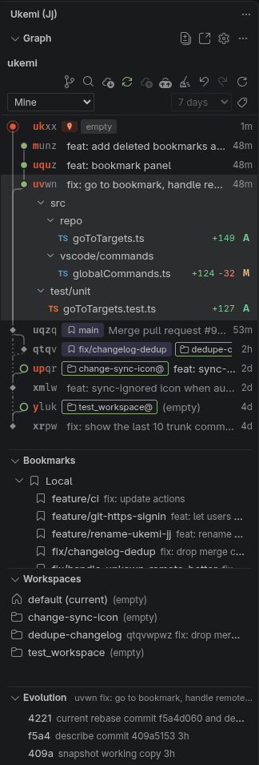

# Ukemi: Jujutsu (jj) GUI

[](https://github.com/samuelba/ukemi/actions/workflows/ci.yml)

<p align="center">
  
</p>

Ukemi is a visual interface for [Jujutsu (jj)](https://jj-vcs.github.io/jj/) in VS Code. In judo, _ukemi_ is the art of falling safely. With jj and `undo`, every change is safe to try.

Install from the [VS Code Marketplace](https://marketplace.visualstudio.com/items?itemName=samuelba.ukemi-jj) or [Open VSX](https://open-vsx.org/extension/samuelba/ukemi-jj) (Cursor). Site: [ukemi.samuelba.dev](https://ukemi.samuelba.dev).

<p align="center">
  
</p>

## Features

- **Change graph.** See your changes, bookmarks, tags, workspaces and conflicts. The working copy has a red seal. Filter by _Recent_, _Mine_, _My history_, _Stack_ or _Working copy_ (the working copy and its last 5 first parents) and choose the history depth. _Recent_ also shows the last 10 commits on the trunk. Changed files appear as a list or a tree.
- **Drag and drop.** Drag a change onto another change to rebase it with its descendants. Hold Alt to move only that change. Hold Ctrl to duplicate it onto the target, and hold Ctrl and Alt to duplicate it with its descendants. Drag a file to move its changes, or hold Ctrl to copy them. Drag a bookmark to move it.
- **Edit history.** Use the context menu or the hover action to describe, create, edit, squash, split, abandon, duplicate and revert changes. Rebase onto the trunk, onto another change, or insert the change before or after another. **Ship to Trunk Now** moves the trunk bookmark to that change and pushes it. **New Change from Trunk** starts a working copy on the trunk. **New Change from Bookmark, Request or Revision** opens a new working copy there. When a local bookmark and a remote bookmark share a name, Ukemi asks which one to use. Click a change to show or hide its files.
- **Bookmarks.** The Bookmarks panel lists local bookmarks and remote bookmarks. **Filter Bookmarks** in the view title filters that list by bookmark name. Hover a row to open it as the working copy, edit, rename, delete, forget, track, untrack or push it. The context menu can also create a pull or merge request, or a new workspace.
- **Workspaces.** The Workspaces panel lists workspaces. Open one in this window or a new window, open a terminal, refresh it, reveal it in the graph, or start a new change in it.
- **Split by hunks.** Select hunks in a split editor. The selected hunks go into a new change before the original. You can also split by files.
- **Evolution.** The Evolution panel shows how the selected change evolved: each amend, describe, snapshot and rebase. Select a change in the graph. Click a version to see what it changed, compare it with the current version, or restore its files. **Follow the Selected Change** keeps the panel on the change you select.
- **Diffs.** Click a file to see its diff. The Source Control view shows the working copy for repositories that the Git extension does not show. Turn on `ukemi.showEditorTitleDiff` to add an **Open Changes (jj)** button to the editor title.
- **Sync.** Fetch, push the current bookmark, push all bookmarks, undo and redo from the toolbar. Auto fetch stays off until you turn it on. SSH remotes use your SSH agent. For HTTPS remotes, Ukemi uses your git credential helper first, then your GitHub sign-in in the editor or your GitLab sign-in. For GitHub, you can also choose a user name and a personal access token with the `repo` scope. Use **Sign In to GitHub or GitLab** to change the choice, and **Sign Out of GitHub or GitLab** to remove a stored token.
- **Pull and merge requests.** Create GitHub pull requests and GitLab merge requests from a change. Ukemi asks which branch to target and proposes the parent bookmark first, so the next request in a stack targets the one below it. See their status and CI result in the graph. Hover a request you opened to see the jobs, and use the open icon to open it in the browser. Merge them and clean up after the merge.
- **Clean up.** Review merged and conflicted bookmarks, deleted remote bookmarks, workspaces that are not open, and divergent changes, then apply the selection.
- **Many repositories.** Ukemi finds repositories in subfolders, for example `tools/firmware/repo`. When it finds more than one, select it in the dropdown. Ukemi follows the active editor.
- **No setup.** When jj is missing, Ukemi offers to download the official static release and checks its SHA-256 digest. That binary can be added to `PATH` in integrated terminals.

## Requirements

- Linux (tested on Ubuntu 24.04 and Fedora 41).
- jj 0.40 or later. Ukemi downloads jj 0.46 when you agree.

## Settings

Select the gear in the title bar of the Ukemi view to open the Ukemi settings.

| Setting                              | Purpose                                                                                           |
| ------------------------------------ | ------------------------------------------------------------------------------------------------- |
| `ukemi.jjPath`                       | Path to jj. Empty means search `PATH` and common folders.                                         |
| `ukemi.addJjToTerminalPath`          | Add the jj binary that Ukemi downloaded to `PATH` in integrated terminals. Default: on.           |
| `ukemi.showSourceControl`            | When to show the working copy in Source Control: `auto`, `always` or `never`.                     |
| `ukemi.showInPanel`                  | Open the change graph in an editor tab. Default: off.                                             |
| `ukemi.showEditorTitleDiff`          | Show **Open Changes (jj)** in the editor title. Default: off.                                     |
| `ukemi.followActiveEditor`           | Switch to the repository of the active editor. Default: on.                                       |
| `ukemi.repoScanDepth`                | Folder levels to search for repositories. Default: 4.                                             |
| `ukemi.repoScanExclude`              | Folder names to skip during the repository search.                                                |
| `ukemi.defaultFilter`                | Filter that the graph shows first.                                                                |
| `ukemi.historyDepth`                 | Default history depth: `7d`, `14d`, `30d`, `1y` or `all`.                                         |
| `ukemi.changeIdLength`               | Minimum number of change ID characters to show. Default: 4.                                       |
| `ukemi.showFullPaths`                | Show full file paths in the graph. Default: off.                                                  |
| `ukemi.showLineStats`                | Show added and removed line counts. This reads those file contents on each refresh. Default: off. |
| `ukemi.showGitTags`                  | Show git tags on changes. Default: on.                                                            |
| `ukemi.changedFilesView`             | Show changed files as a `list` or a `tree`.                                                       |
| `ukemi.workspaces.snapshotOnRefresh` | Snapshot every other workspace on each refresh. Default: off. Each snapshot is a jj operation.    |
| `ukemi.autoFetch.enabled`            | Fetch the active repository on a timer. Default: off.                                             |
| `ukemi.autoFetch.interval`           | How often to fetch when auto fetch is on. Example: `10m`. Minimum: 10 seconds.                    |
| `ukemi.github.hosts`                 | GitHub Enterprise hosts, for example `github.example.com`.                                        |
| `ukemi.gitlab.hosts`                 | Self-hosted GitLab hosts, for example `git.example.com`.                                          |
| `ukemi.gitlab.oauthApplications`     | GitLab OAuth client IDs by host. The client ID is not a secret.                                   |
| `ukemi.forge.ciOnlyMine`             | Show CI status only on open requests that you authored. Default: on.                              |
| `ukemi.forge.requestLimit`           | How many recently updated merge and pull requests to load. Default: 50. Maximum: 500.             |
| `ukemi.forge.statusInterval`         | How often to reload CI status. Default: `60s`, or 15s while your pipeline runs.                   |

## Sign in

- **GitHub** uses the GitHub account of the editor, or a personal access token with the `repo` scope.
- **GitLab** tries, in order: an OAuth session, a personal access token, then the `glab` CLI. For `glab`, Ukemi runs `glab api --hostname <host>` and does not read the token. `glab` sends its own `Bearer` header and refreshes a web login.
- OAuth and personal access tokens are stored in VS Code secret storage. On Linux that is the OS keyring (libsecret), not a clear-text file. **Sign Out** removes both and stops using `glab` until the next sign-in. The `glab` login itself stays in `glab`.

### GitLab OAuth application

OAuth needs a non-confidential application on that GitLab host, with the `api` scope and these redirect URIs:

- `vscode://samuelba.ukemi-jj/gitlab-auth`
- `cursor://samuelba.ukemi-jj/gitlab-auth`

Put the client ID in `ukemi.gitlab.oauthApplications`, for example `{ "git.example.com": "abc123" }`. If the host has no client ID, Ukemi asks for a personal access token with the `api` scope instead.

`ukemi.forge.statusInterval` sets how often CI status refreshes. The default is 60 seconds, and 15 seconds while one of your pipelines is running. It pauses while the window is not focused.

## Development

Install the dependencies once:

```sh
npm install
```

### Run from source

1. Open the `ukemi` folder in VS Code: `code ukemi`. The launch configuration is in `ukemi/.vscode`.
2. Press F5, or select **Run Ukemi** in the Run and Debug view. The `watch` task builds the code first.
3. In the new Extension Development Host window, open a folder that contains a jj repository.
4. Select the Ukemi icon in the activity bar.

The launch configuration disables VisualJJ in the development window, so that only one jj view shows.

### Live changes

The `watch` task stays active and rebuilds `dist/` each time you save. There is no hot reload. After a rebuild:

| You changed                  | Do this in the Extension Development Host                             |
| ---------------------------- | --------------------------------------------------------------------- |
| `webview/src/**`             | Run **Developer: Reload Webviews**, or close and open the Ukemi view. |
| `src/**` or `shared/**`      | Run **Developer: Reload Window** (Ctrl+R).                            |
| `package.json` contributions | Stop the debug session and press F5 again.                            |

To watch without the debugger, run `npm run watch` in a terminal.

### Test and package

```sh
npm test            # unit and integration tests, needs jj on PATH
npm run test:e2e    # runs the extension inside the installed VS Code
npm run package     # builds ukemi-jj-0.2.0.vsix
```

### Install the VSIX

```sh
code --install-extension ukemi-jj-0.2.0.vsix
```

In Cursor, `npm run install:cursor` packages and installs in one step.

Then run **Developer: Restart Extension Host** or **Developer: Reload Window**. The editor keeps the old code loaded and does not ask for a restart when the version number is the same. To remove it, run `code --uninstall-extension samuelba.ukemi-jj`.

## Release

A push to `main` does not publish. [release-please](https://github.com/googleapis/release-please) opens a release pull request from conventional commits (`feat` bumps minor before 1.0, `fix` bumps patch, `feat!` bumps major after 1.0). Merging that pull request creates the `vX.Y.Z` tag, the GitHub Release, and attaches `ukemi-jj-X.Y.Z.vsix`. Merge commits are removed from those notes afterward.

Set the repository secret `RELEASE_PLEASE_TOKEN` to a fine-grained personal access token if CI should run on that pull request. Without it, the release still works.
